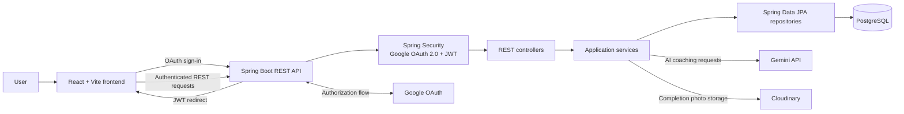

# FocusFlow Architecture

## Request flow

- Google OAuth authenticates a user through the backend. On success, the backend issues a JWT to the frontend.
- The frontend sends the JWT with requests to protected `/api/**` endpoints.
- Controllers delegate application operations to services. Services use repositories to read and write PostgreSQL data.
- The chatbot service calls Gemini for AI responses, while photo uploads are stored with Cloudinary.
